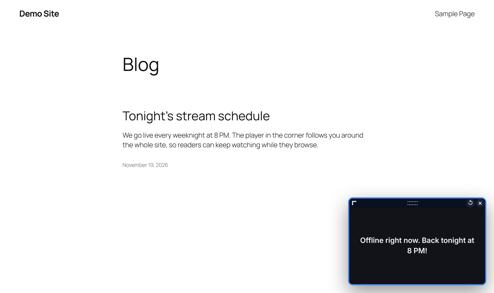
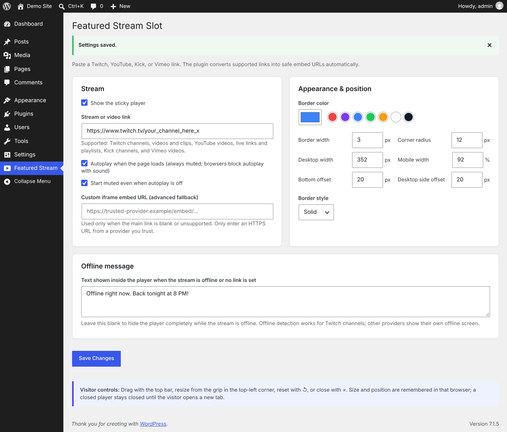
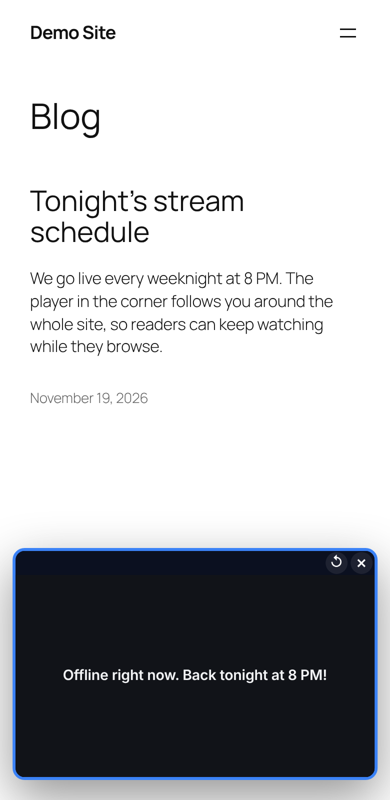

# Featured Stream Slot

A WordPress plugin that pins a live stream to the corner of every page. Paste a Twitch, YouTube, Kick or Vimeo link and your visitors get a small floating player that autoplays muted, can be dragged, resized or closed, and shows your own message when the stream is offline.

I created it for my own website in the tech and gaming niche.



## Features

- **Floating player on every page.** Sits bottom-right on desktop and bottom-center on phones, above your theme and out of the way.
- **Twitch, YouTube, Kick and Vimeo.** Paste a normal link (channel, video, clip, live link or playlist) and the plugin builds the correct embed URL, including Twitch's `parent` parameter for both `example.com` and `www.example.com`.
- **Fast muted autoplay.** The iframe is written at the top of `<body>` with `preconnect` hints in the head, so the stream starts while the page is still loading. No Twitch SDK, no waiting.
- **Twitch autoplay that actually works.** The video is drawn at its real size with nothing on top of it (Twitch silently refuses to autoplay a player that is scaled with a CSS transform, faded or covered). If Twitch reports ready but never starts, the embed is reloaded once.
- **Offline message.** For Twitch channels the plugin listens to the player's events and swaps in your own text when the channel goes offline. Leave the message blank to hide the player instead.
- **Visitor controls.** Drag by the top bar, resize from the top-left grip, reset with ↺, close with ×. Size and position are remembered per browser; a closed player stays closed for the rest of that tab's session.
- **Styling from the admin.** Border color (with presets), width, style and corner radius, desktop width, mobile width and offsets.
- **Lightweight.** One small CSS file and one small vanilla JS file, no jQuery, no external requests until the stream itself loads.
- **Clean uninstall.** Deleting the plugin removes its options.

## Screenshots

| Settings page | On a phone |
| --- | --- |
|  |  |

## Installation

1. Download the plugin: [featured-stream-slot (zip)](https://github.com/christianc24/featured-stream-slot/archive/refs/heads/main.zip).
2. In WordPress go to **Plugins → Add New Plugin → Upload Plugin**, choose the zip and activate it.
3. Open **Featured Stream** in the admin menu, paste your stream link and save.

Or clone straight into your plugins folder:

```bash
cd wp-content/plugins
git clone https://github.com/christianc24/featured-stream-slot.git
```

**Requirements:** WordPress 6.0+, PHP 7.4+. Your theme should call `wp_body_open()` (almost every modern theme does); if it doesn't, the player is printed in the footer instead.

## Supported links

| Provider | Examples |
| --- | --- |
| Twitch | `https://twitch.tv/channel`, `https://twitch.tv/videos/123456`, `https://twitch.tv/channel/clip/Slug`, `https://clips.twitch.tv/Slug` |
| YouTube | `https://youtube.com/watch?v=ID`, `https://youtu.be/ID`, `https://youtube.com/live/ID`, `https://youtube.com/playlist?list=ID` |
| Kick | `https://kick.com/channel` |
| Vimeo | `https://vimeo.com/123456`, `https://vimeo.com/123456/hash` |
| Anything else | Use the **Custom iframe embed URL** field (HTTPS only). |

Browsers only allow autoplay when the video is muted, so autoplay always starts muted. Twitch does not autoplay on phones at all; visitors tap to play.

## For developers

Two filters let you control the player from a theme or a small plugin.

```php
// Hide the player on specific pages.
add_filter( 'ssp_should_render', function ( $show ) {
	return is_page( array( 'checkout', 'contact' ) ) ? false : $show;
} );

// Change settings per request, e.g. a different channel on one category.
add_filter( 'ssp_settings', function ( $settings ) {
	if ( is_category( 'tournaments' ) ) {
		$settings['stream_url'] = 'https://twitch.tv/another_channel';
	}
	return $settings;
} );
```

Settings are stored in the `ssp_settings` option. The player markup is an `<aside id="ssp-player">` with CSS custom properties (`--ssp-border`, `--ssp-radius`, `--ssp-inner-width` and so on), so it is easy to restyle from your theme.

## Contributing

Issues and pull requests are welcome. Please keep the plugin dependency-free and test Twitch autoplay on a real channel if you touch the player layout.

## License

[GPL-2.0-or-later](LICENSE), like WordPress itself.

Made by [christianc24](https://github.com/christianc24).
